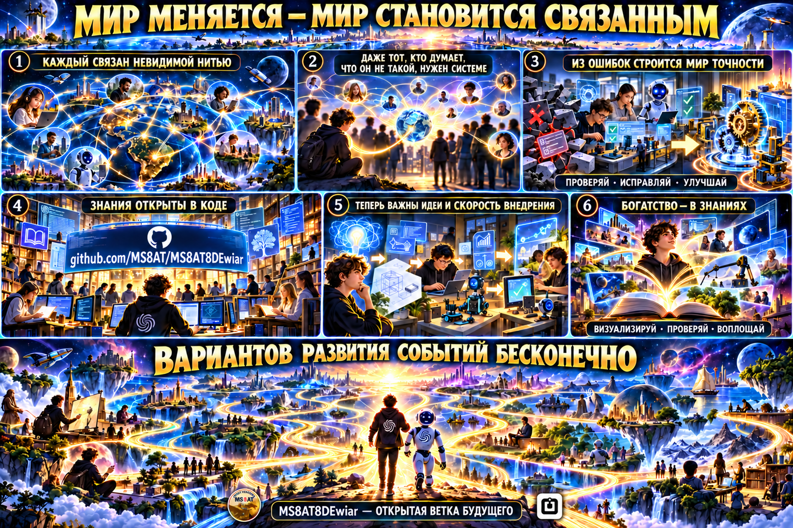

# Иллюстрации MS8AT8DWiar · Artwork · 项目插图

Эти изображения созданы для публичного объяснения идеи проекта. Они не являются скриншотами успешно выполненной
установки или доказательством работы live-модели. / These images explain the public project concept; they are not
proof of a successful installation or live-model execution. / 这些图片用于说明公开项目理念，不代表安装成功，也不是实时模型运行的证明。

## Карта проекта · Project map · 项目地图

Человек задаёт направление, Dewiar помогает маршрутизировать задачи между подходящими AI-контурами, а журнал,
проверка и ручное управление сохраняют контроль. / A person sets direction; Dewiar routes work to suitable AI
circuits while journals, verification, and manual controls preserve oversight. / 人决定方向，Dewiar 把任务路由到合适的
AI 模型；日志、验证与人工控制确保过程可控。

## Связанный мир · Connected world · 互联世界

Иллюстрация экосистемы Dewiar и MS8AT. / An illustration of the Dewiar and MS8AT ecosystem. / Dewiar 与 MS8AT 生态插图。
